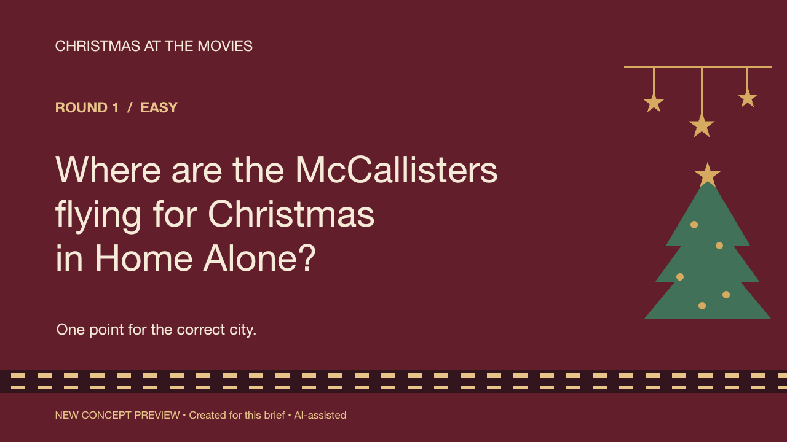
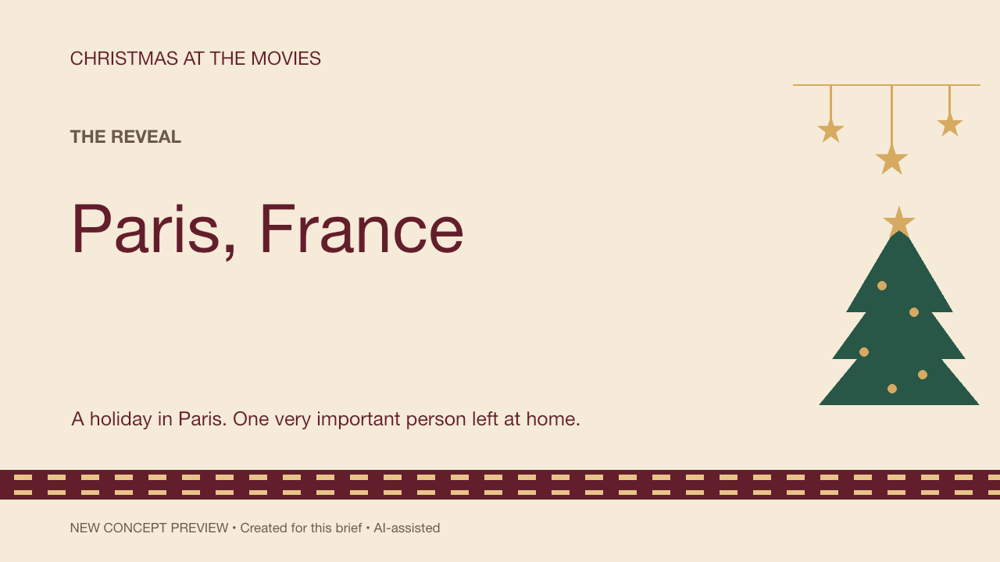

# Christmas at the movies

A new two-slide concept, created with AI. This is a style sample, not previous client work or a complete game.

[Download the editable PowerPoint](christmas-trivia-preview.pptx)

The sample uses editable text and original vector decorations. It contains one question and answer, with click-to-advance fade transitions. The images show the rendered layout; playback in your PowerPoint version is not yet verified.

Question fact: the McCallister family travels to Paris in *Home Alone* (1990), as described in the official [20th Century Studios synopsis](https://www.20thcenturystudios.com/movies/home-alone). No movie stills are included.
